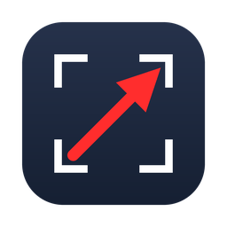
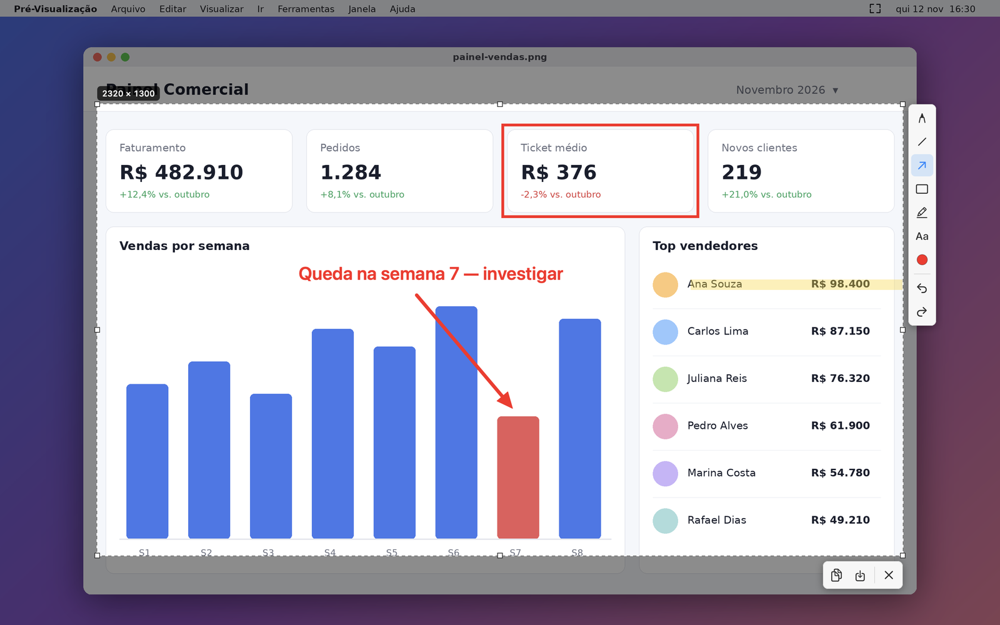
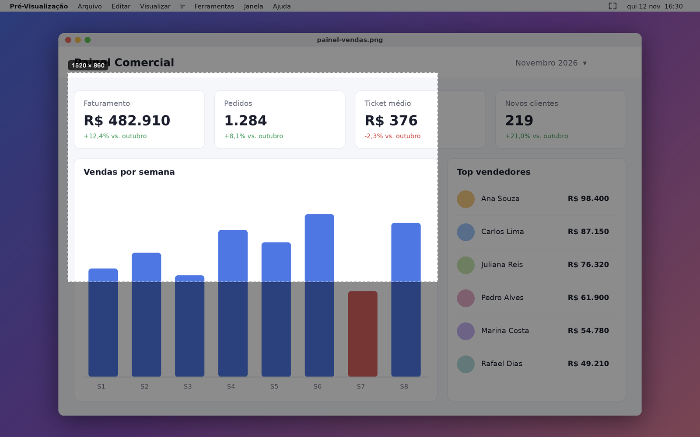
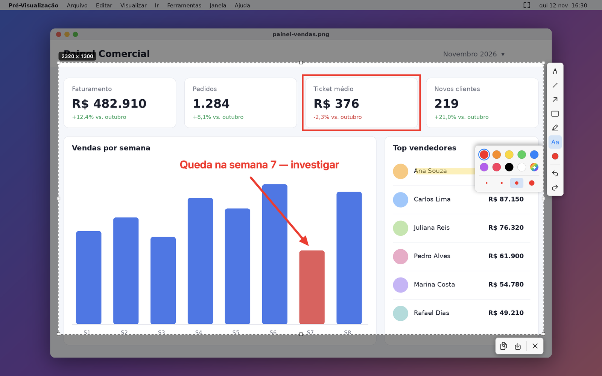
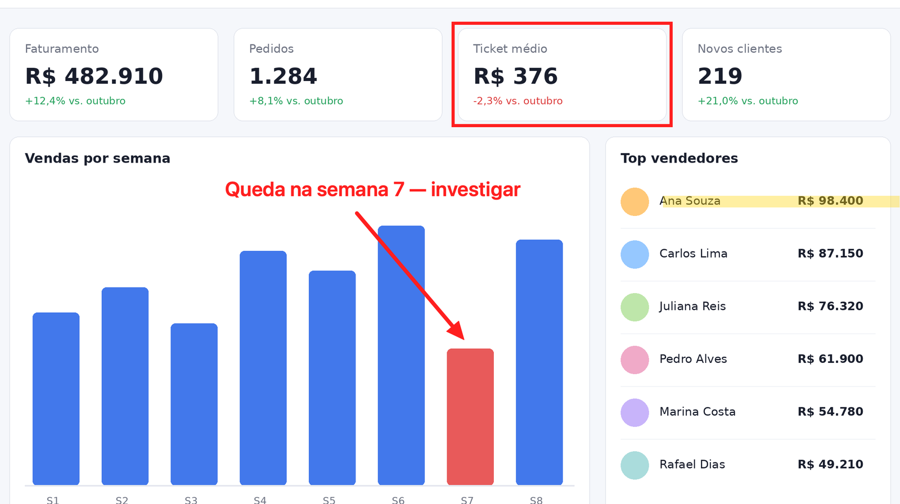
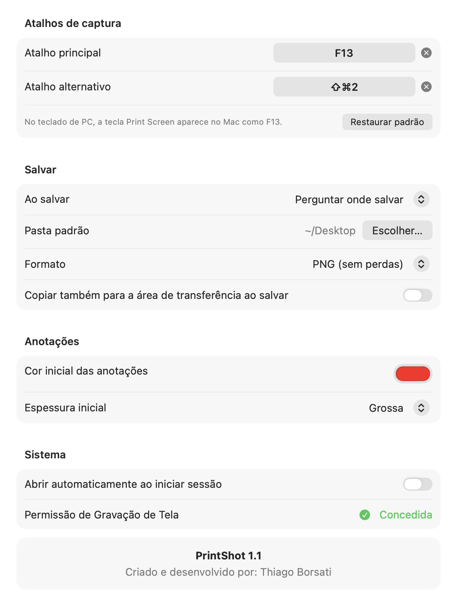

<p align="center">
  
</p>

<h1 align="center">PrintShot</h1>

<p align="center">
  Captura de tela para macOS no estilo Lightshot, <b>nativa para Apple Silicon</b> (M1, M2, M3, M4).<br>
  Selecione uma área, anote com setas, retângulos e texto, e copie ou salve.
</p>

<p align="center">
  <a href="https://github.com/thiagobrst/PrintShot/releases/latest"><b>⬇️ Baixar o instalador (.dmg)</b></a>
</p>

<p align="center">
  
</p>

## Por que existe

O Lightshot para Mac só tem versão para processadores Intel, então nos Macs com Apple Silicon ele roda emulado pelo Rosetta.
O PrintShot traz o mesmo fluxo rápido (atalho → seleciona → rabisca → cola) num app nativo, leve e sem conta, upload ou anúncio.

## Recursos

- **Atalho global configurável:** F13 (a tecla *Print Screen* de teclados de PC) e ⌘⇧2 por padrão, ou qualquer combinação que você gravar
- **Seleção de área** com alças para mover e redimensionar, tamanho em pixels e suporte a vários monitores
- **Ferramentas de anotação:** seta, linha, retângulo, lápis, marca-texto e texto, com cores e espessuras
- **Copiar** para a área de transferência (⌘C ou ↩) ou **salvar** em PNG/JPEG (⌘S), sempre em resolução Retina
- Desfazer/refazer (⌘Z / ⇧⌘Z), ⇧ para linhas a 45° e quadrados, setas do teclado para ajustar a seleção
- Ícone discreto na barra de menus, sem ícone na Dock; opção de abrir ao iniciar sessão

| Selecionar | Paleta de cores | Resultado copiado |
|---|---|---|
|  |  |  |

<p align="center">
  
</p>

## Instalar

1. Baixe o `PrintShot-x.y.dmg` na página de [Releases](https://github.com/thiagobrst/PrintShot/releases/latest).
2. Abra o arquivo e arraste o **PrintShot** para a pasta **Aplicativos**.
3. **Primeira abertura:** o app não é assinado com uma conta paga de desenvolvedor da Apple, então o macOS bloqueia na primeira vez.
   Tente abrir o PrintShot, clique em **OK** no aviso e vá em *Ajustes do Sistema › Privacidade e Segurança*. Role até o aviso sobre o PrintShot e clique em **Abrir Mesmo Assim**.
   <br>Se preferir o Terminal: `xattr -dr com.apple.quarantine /Applications/PrintShot.app`
4. Na primeira captura, permita a **Gravação de Tela** em *Ajustes do Sistema › Privacidade e Segurança › Gravação de Tela e Áudio do Sistema* e reabra o app.

Requer macOS 14 (Sonoma) ou mais recente.

## Atalhos

| Ação | Atalho |
|---|---|
| Capturar | F13 / Print Screen, ⌘⇧2, ou clique no ícone da barra de menus |
| Lápis · Linha · Seta · Retângulo · Marca-texto · Texto | P · L · A · R · M · T |
| Copiar e fechar | ⌘C ou ↩ |
| Salvar | ⌘S |
| Desfazer / Refazer | ⌘Z / ⇧⌘Z |
| Tela inteira | ⌘A |
| Mover seleção | Setas (⇧ = 10 px, ⌥ = redimensionar) |
| Espessura | Rodinha do mouse / trackpad |
| Cancelar | Esc |

**Quer usar ⌘⇧4?** Desative o atalho do macOS em *Ajustes › Teclado › Atalhos de Teclado › Capturas de Tela* e grave ⌘⇧4 nas Preferências do PrintShot.

## Compilar a partir do código

Só precisa das Command Line Tools da Apple (`xcode-select --install`), sem Xcode:

```bash
./build.sh install     # compila, copia para /Applications e abre
./make_dmg.sh          # gera dist/PrintShot-<versão>.dmg
```

Feito em Swift com AppKit, ScreenCaptureKit e SwiftUI (Preferências). As imagens em `docs/screenshots` são geradas pelo próprio código do app com `Gerar Imagens Demo.command`.

---

## English

**PrintShot** is a free, open-source, Lightshot-style screenshot tool for macOS, native on Apple Silicon.
Press F13 (Print Screen on PC keyboards) or ⌘⇧2, drag to select, annotate with arrows, rectangles, text and highlighter, then copy (⌘C) or save (⌘S).
Download the `.dmg` from [Releases](https://github.com/thiagobrst/PrintShot/releases/latest). Since the app isn't notarized, on first launch go to *System Settings › Privacy & Security* and click **Open Anyway**. Requires macOS 14+.

---

Criado e desenvolvido por **Thiago Borsati** · Licença [MIT](LICENSE)
